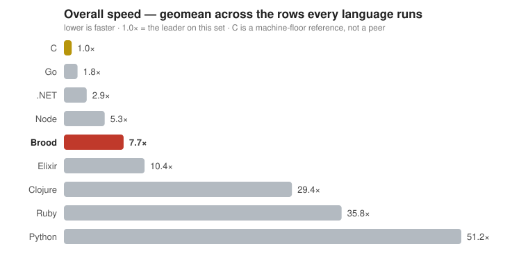
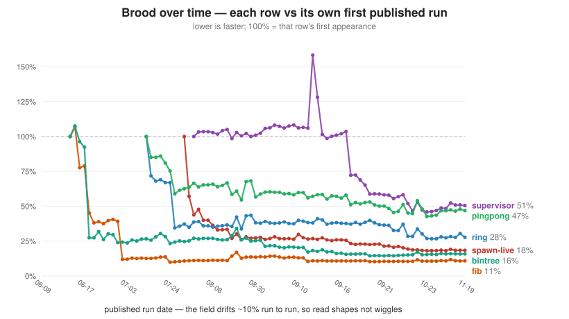

# Brood benchmarks — against eight other languages

31 programs under one harness, measuring Brood's startup, memory, compute and concurrency
against mature runtimes: a snapshot of where it stands, not a claim to lead. **C** is a
machine-floor reference for 16 compute rows, not a peer ([why](bench/c/README.md)). **Go** sits
between C and .NET and runs every managed row ([notes](bench/go/README.md)).



Geometric mean over the 15 rows every column runs. Not comparable with runs before 2026-08-14,
when adding C changed the row set and the reference.

### Brood over time



Each row against its own first published run: the chart to read for progress. Rows are compared
only at the same `N`.

<!-- BEGIN STANDINGS (generated by nest run -- docs) -->
**Brood measured 2026-11-19; the other languages 2026-09-16.** Full tables: [BENCHMARKS.md](BENCHMARKS.md).

| | Brood | field |
|---|---|---|
| startup (wall) | 16.6 ms | C 2.0, Go 2.3, Python 10.0, Node 17.8, .NET 21.5, Ruby 38.4, Elixir 179.0, Clojure 330.0 ms |
| base RSS | 60.5 MB | C 1.7, Go 1.8, Python 9.8, Ruby 19.3, .NET 26.0, Node 42.8, Elixir 70.5, Clojure 103.2 MB |
| overall speed — geomean of the 15 rows every column implements | 7.7× the fastest (5/9) | C 1.0 · Go 1.8 · .NET 2.9 · Node 5.3 · Elixir 10.4 · Clojure 29.4 · Ruby 35.8 · Python 51.2 |
| aggregate single-threaded compute | 4.0× the fastest | C 1.0 · Go 1.4 · .NET 2.0 · Node 4.5 · Elixir 7.2 · Clojure 14.6 · Ruby 25.0 · Python 53.1 |
| aggregate vs the field's average | **0.66×** | ahead of the field average on 6 of 11 core-compute rows |
| rank by row | 1st on `http`; last on — | |
| `spawn-live` (300k units held alive, each sent a copied message) | 971 ms, 1.30 GB, 3.00 CPU·s | Elixir 662 ms / 924 MB — the only peer; Node 215 ms / 247 MB, .NET 261 ms / 138 MB, Python 1.25 s / 361 MB, Go 466 ms / 847 MB are coroutines on a shared heap |
| `supervisor` (20k supervised children, a quarter retired and restarted) | 415 ms, 469 MB | Elixir 256 ms / 153 MB — the only peer; no other runtime here has a supervisor |
| `latency` p99 / p99.9 (20k req/s, 5% of them occupying 500µs) | **70 µs / 455 µs** | Elixir 54 / 66 µs · Go 104 / 106 µs · Python 423 / 479 µs · Node 450 / 643 µs · .NET 629 / 12760 µs — the compute winner has the worst tail |
<!-- END STANDINGS -->

## Read more

- **[BENCHMARKS.md](BENCHMARKS.md)**: every row and language, with methodology.
- **[Why C and .NET are faster](BENCHMARKS.md#why-c-and-net-are-faster)**: and what it means for
  everyday code.
- **[FRONTIER.md](FRONTIER.md)**: Brood's gaps and what would close them.
- **[bench/c/README.md](bench/c/README.md)**: what the C column measures.
- **[results/report.md](results/report.md)** / **[results.json](results/results.json)**: the raw
  output.

## Running it

```sh
nest run -- harness                               # full suite, best of 3 → results/
nest run -- harness --only fib --langs brood,c    # a subset
nest run -- chart && nest run -- trend && nest run -- docs
```

Sources are in [`bench/`](bench/), named identically per language (`fib.blsp`, `fib.c`, …) so
they diff side by side; `BENCH_N=35 brood bench/brood/fib.blsp` runs one standalone. Every
program prints one checksum and the harness fails the run if the columns disagree. Rankings use
**compute = wall − that language's `startup`**.

## Environment

<!-- BEGIN ENVIRONMENT (generated by nest run -- docs) -->
Numbers in the docs were measured on `whklat`: a 12-core x86-64 Linux 7.0.0 machine · Brood 0.55.0 (`d5e52aaf6`) (bytecode VM + tier-1 JIT) · Clojure 1.12.5 / OpenJDK 25.0.4 (HotSpot) · Elixir 1.21.0-dev (b82c44a) / OTP 28 (BeamAsm JIT) · Python 3.14.4 · Node 22.21.0 (V8) · ruby 3.3.8 · .NET 10.0.112 (RyuJIT) · Go 1.24.2 (gc). 2026-09-16.
<!-- END ENVIRONMENT -->

## License

Licensed under the GNU Affero General Public License v3.0 (`AGPL-3.0-only`); see
[`LICENSE`](LICENSE). Copyright © 2026 Wilhelm Kirschbaum.
