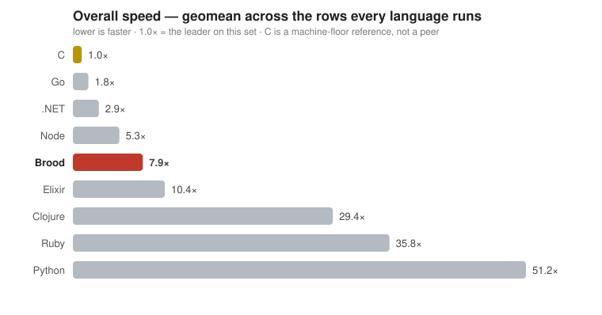
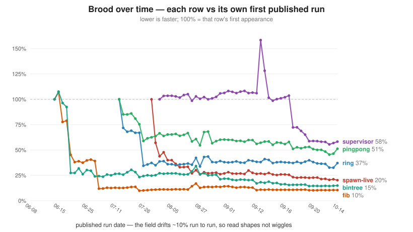

# benchmark — Brood vs C vs Go vs Clojure vs Elixir vs Python vs Node vs Ruby vs .NET

**31 programs under one harness**, measuring where the Brood runtime stands on startup,
memory, compute and concurrency. Brood is a young runtime measured against mature ones:
a "where does it stand today" snapshot, not a claim to lead. **C is a machine-floor
reference** — 16 compute rows, not a peer ([why not all 31](bench/c/README.md)). **Go** is the
compiled, garbage-collected, goroutine-scheduled point between C and .NET
([bench/go/README.md](bench/go/README.md)); it runs every row the managed runtimes run.



Geometric mean over the 15 rows every column runs, so each benchmark counts once whatever its
absolute size. **Not comparable with runs before 2026-08-14:** adding C narrowed that set from 27
rows to 15 and moved the reference from .NET to C, so the multiples grew without anything getting
slower — the denominator moved. (Go, added 2026-09-16, runs every one of those 15 rows, so it
changed nothing about the set.) Memory per language is in the standings table below.

### Brood over time



Per-row, each against its own first published run — immune to the rebase above, which is why this
is the chart to read for progress rather than the scalar. Across every published run at this size:
`fib` **−89%**, `bintree` **−85%**, `spawn-live` **−82%** (5362 → 976 ms), `ring` **−73%**,
`pingpong` **−56%** — and `supervisor`, the one line that had gone the other way at the 2026-09-14
field run, which the two 2026-09-15 refreshes took back below where it started: the regression was
the type checker, not the supervisor (brood KI-138 and KI-139, both fixed), and the story is in
[BENCHMARKS.md](BENCHMARKS.md#concurrency--only-two-of-these-are-the-same-thing).
Rows are only compared across runs at the same `N`.

<!-- BEGIN STANDINGS (generated by nest run -- docs) -->
**2026-09-16 run.** Numbers regenerate with each run; the full table is in [BENCHMARKS.md](BENCHMARKS.md).

| | Brood | field |
|---|---|---|
| startup (wall) | 14.8 ms | C 2.0, Go 2.3, Python 10.0, Node 17.8, .NET 21.5, Ruby 38.4, Elixir 179.0, Clojure 330.0 ms |
| base RSS | 54.6 MB | C 1.7, Go 1.8, Python 9.8, Ruby 19.3, .NET 26.0, Node 42.8, Elixir 70.5, Clojure 103.2 MB |
| overall speed — geomean of the 15 rows every column implements | 7.7× the fastest (5/9) | C 1.0 · Go 1.8 · .NET 2.9 · Node 5.3 · Elixir 10.4 · Clojure 29.4 · Ruby 35.8 · Python 51.2 |
| aggregate single-threaded compute | 3.9× the fastest | C 1.0 · Go 1.4 · .NET 2.0 · Node 4.5 · Elixir 7.2 · Clojure 14.6 · Ruby 25.0 · Python 53.1 |
| aggregate vs the field's average | **0.65×** | ahead of the field average on 6 of 11 core-compute rows |
| rank by row | 1st on `http`; last on — | |
| `spawn-live` (300k units held alive, each sent a copied message) | 961 ms, 1.29 GB, 2.96 CPU·s | Elixir 662 ms / 924 MB — the only peer; Node 215 ms / 247 MB, .NET 261 ms / 138 MB, Python 1.25 s / 361 MB, Go 466 ms / 847 MB are coroutines on a shared heap |
| `supervisor` (20k supervised children, a quarter retired and restarted) | 384 ms, 468 MB | Elixir 256 ms / 153 MB — the only peer; no other runtime here has a supervisor |
| `latency` p99 / p99.9 (20k req/s, 5% of them occupying 500µs) | **71 µs / 156 µs** | Elixir 54 / 66 µs · Go 104 / 106 µs · Python 423 / 479 µs · Node 450 / 643 µs · .NET 629 / 12760 µs — the compute winner has the worst tail |
<!-- END STANDINGS -->

## Read more

- **[BENCHMARKS.md](BENCHMARKS.md)** — every benchmark × language, the per-row tables,
  methodology and the fairness rules.
- **[FRONTIER.md](FRONTIER.md)** — where Brood's gaps are and what would move them.
- **[bench/c/README.md](bench/c/README.md)** — what the C column does and does not measure.
- **[results/report.md](results/report.md)** / **[results.json](results/results.json)** — the latest
  run's raw output, with every benchmark and what it stresses.

## Running it

```sh
nest run -- harness                        # full suite, best of 3 → results/
nest run -- harness --only fib --langs brood,c   # a subset
nest run -- chart && nest run -- trend && nest run -- docs   # charts + docs
```

Sources live in [`bench/`](bench/), one file per benchmark per language, named identically
except the extension (`fib.blsp` / `fib.c` / `fib.clj` / `fib.ex` / …) so they diff side by
side. Sizes come from `BENCH_N`, so any program also runs standalone:
`BENCH_N=35 brood bench/brood/fib.blsp`.

Every program prints one integer and the harness **fails the run if the columns disagree**, so
the work is provably equivalent; generated data uses one identical LCG
(`x = (x*1103515245 + 12345) & 0x7fffffff`, seed `123456789` — Node needs `BigInt` to stay
bit-identical past 2^53). Rankings use **compute = wall − that language's own `startup` time**,
so a slow-booting runtime's real speed is visible.

## Environment

<!-- BEGIN ENVIRONMENT (generated by nest run -- docs) -->
Numbers in the docs were measured on `whklat`: a 12-core x86-64 Linux 7.0.0 machine · Brood 0.43.0 (`3333b20b`) (bytecode VM + tier-1 JIT) · Clojure 1.12.5 / OpenJDK 25.0.4 (HotSpot) · Elixir 1.21.0-dev (b82c44a) / OTP 28 (BeamAsm JIT) · Python 3.14.4 · Node 22.21.0 (V8) · ruby 3.3.8 · .NET 10.0.112 (RyuJIT) · Go 1.24.2 (gc). 2026-09-16.
<!-- END ENVIRONMENT -->

## License

Licensed under the GNU Affero General Public License v3.0 (`AGPL-3.0-only`); see
[`LICENSE`](LICENSE). Copyright © 2026 Wilhelm Kirschbaum.
